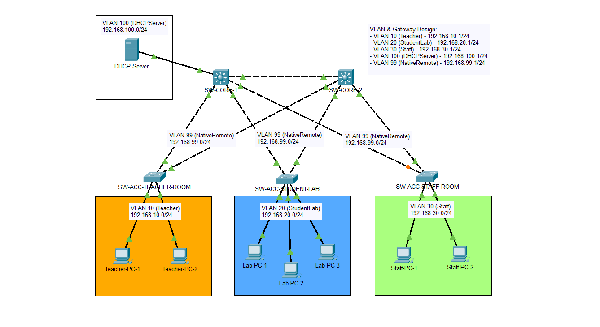

# Broadcast Storms Handling Simulation

A Cisco Packet Tracer school network that demonstrates how redundant Layer 2 uplinks can cause broadcast storms and MAC address flapping when Spanning Tree Protocol (STP) is disabled, and how PVST+, root bridge selection, PortFast, and BPDU Guard help prevent those issues.

**Tools:** Cisco Packet Tracer · Cisco IOS CLI



## At a glance

| Area               | What is implemented                                                            |
| ------------------ | ------------------------------------------------------------------------------ |
| Switching          | 2 Layer 3 core switches and 3 Layer 2 access switches                          |
| Redundancy         | Dual uplinks from each access switch to both core switches                     |
| Spanning tree      | PVST+ with per-VLAN root bridge selection                                      |
| Inter-VLAN routing | SVIs on both core switches with DHCP relay to `192.168.100.10`                 |
| Access protection  | PortFast and BPDU Guard on end-device access ports                             |
| Simulation         | STP-disabled and STP-enabled scenarios, DHCP behavior, and BPDU Guard response |

## Devices

| Role                       | Model               | Qty |
| -------------------------- | ------------------- | --- |
| Core / distribution switch | Cisco Catalyst 3650 | 2   |
| Access switch              | Cisco Catalyst 2960 | 3   |
| Packet Tracer project      | `simulation.pkt`    | 1   |

## VLANs and addressing

Each VLAN uses a `/24` subnet. The core switch SVI addresses are listed separately; the configuration does not show HSRP.

| VLAN | Name         | Subnet             | SW-CORE-1 SVI   | SW-CORE-2 SVI   | Primary STP root |
| ---- | ------------ | ------------------ | --------------- | --------------- | ---------------- |
| 10   | Teacher      | `192.168.10.0/24`  | `192.168.10.1`  | `192.168.10.2`  | SW-CORE-1        |
| 20   | StudentLab   | `192.168.20.0/24`  | `192.168.20.1`  | `192.168.20.2`  | SW-CORE-1        |
| 30   | Staff        | `192.168.30.0/24`  | `192.168.30.1`  | `192.168.30.2`  | SW-CORE-2        |
| 99   | NativeRemote | `192.168.99.0/24`  | `192.168.99.1`  | `192.168.99.2`  | SW-CORE-2        |
| 100  | DHCPServer   | `192.168.100.0/24` | `192.168.100.1` | `192.168.100.2` | SW-CORE-1        |

Access-switch trunks use VLAN 99 as the native VLAN and allow only the VLANs needed by each switch. The core SVIs for VLANs 10, 20, and 30 relay DHCP requests to `192.168.100.10`.

## Problem scenario

Each access switch has redundant uplinks to both core switches. With STP disabled, these Layer 2 paths can form a switching loop. Broadcast frames, including DHCP Discover messages, may circulate repeatedly, contributing to a broadcast storm; switches may also report MAC address flapping as source addresses appear on different ports.

## Design decisions

- **PVST+ keeps redundant links loop-free.** STP selects forwarding and blocking paths independently for each VLAN.
- **STP roots are split across the cores.** SW-CORE-1 is primary for VLANs 10, 20, and 100; SW-CORE-2 is primary for VLANs 30 and 99. This distributes the preferred Layer 2 paths by VLAN.
- **PortFast is limited to end-device ports.** Client-facing ports can transition to forwarding promptly without waiting through the usual STP startup delay.
- **BPDU Guard protects edge ports.** A BPDU received on a protected client-facing port can place that port into an error-disabled state, helping prevent an attached switch from creating an unintended loop.
- **Trunks are pruned to operational VLANs.** VLAN 1 is excluded from the configured trunk allow lists.

More detail: [design_decisions.md](design_decisions.md)

## Troubleshooting highlights

| Symptom                                                   | Scenario or cause                                  | Evidence                                                                                                                   |
| --------------------------------------------------------- | -------------------------------------------------- | -------------------------------------------------------------------------------------------------------------------------- |
| DHCP requests fail or continue as broadcasts              | STP-disabled topology with redundant Layer 2 paths | [DHCP broadcast storm](verification/dhcp-brodcast-storms.png), [failed DHCP request](verification/dhcp-request-failed.png) |
| MAC addresses move between switch ports                   | Layer 2 loop behavior in the STP-disabled scenario | [MAC address flapping](verification/mac-address-flapping.png)                                                              |
| A client-facing port is disabled after a BPDU is received | BPDU Guard protection on an access port            | [BPDU Guard error-disabled state](verification/bpdu-guard-err-disabled.png)                                                |

## Verification

The repository includes screenshots for both the failure scenario and the STP-enabled behavior:

| Check                               | Evidence                                                                                                                                                                                                                                           |
| ----------------------------------- | -------------------------------------------------------------------------------------------------------------------------------------------------------------------------------------------------------------------------------------------------- |
| STP-disabled network behavior       | [Before STP is enabled](verification/before-stp-disabled.png)                                                                                                                                                                                      |
| STP-enabled network behavior        | [After STP is enabled](verification/after-stp-enabled.png)                                                                                                                                                                                         |
| DHCP request and broadcast behavior | [DHCP broadcast](verification/dhcp-brodcast-storms.png), [failed request](verification/dhcp-request-failed.png), [successful request](verification/dhcp-request-successful.png), [DHCP broadcast success](verification/dhcp-broadcast-success.png) |
| BPDU Guard response                 | [Error-disabled port](verification/bpdu-guard-err-disabled.png)                                                                                                                                                                                    |
| MAC address behavior                | [MAC address flapping](verification/mac-address-flapping.png)                                                                                                                                                                                      |

See [verification/README_VERIFICATION.md](verification/README_VERIFICATION.md) for the verification folder notes.

## Known limitations and next steps

- This is a Packet Tracer simulation; device behavior may differ from physical Cisco hardware.
- The repository documents per-core SVI addresses but does not configure a shared first-hop gateway protocol such as HSRP.
- The DHCP server configuration is not included as a separate configuration file; the core configurations identify its relay address as `192.168.100.10`.

## Repository layout

```
configs/        Switch startup configurations for both cores and three access switches
topology/       Logical and physical topology images and topology notes
verification/   Screenshots documenting STP, DHCP, MAC flapping, and BPDU Guard behavior
design_decisions.md
simulation.pkt
```
